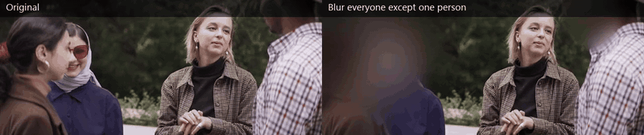
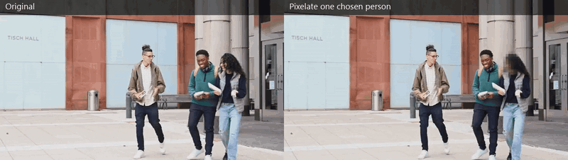
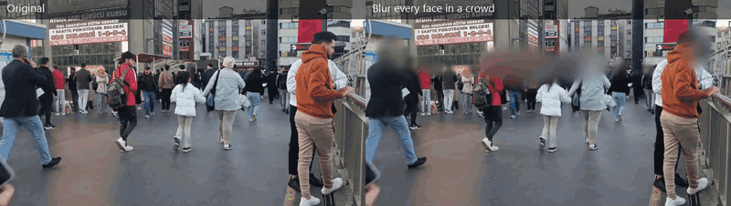
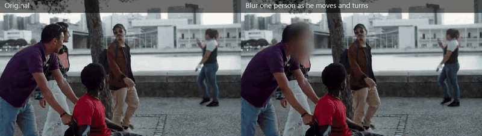
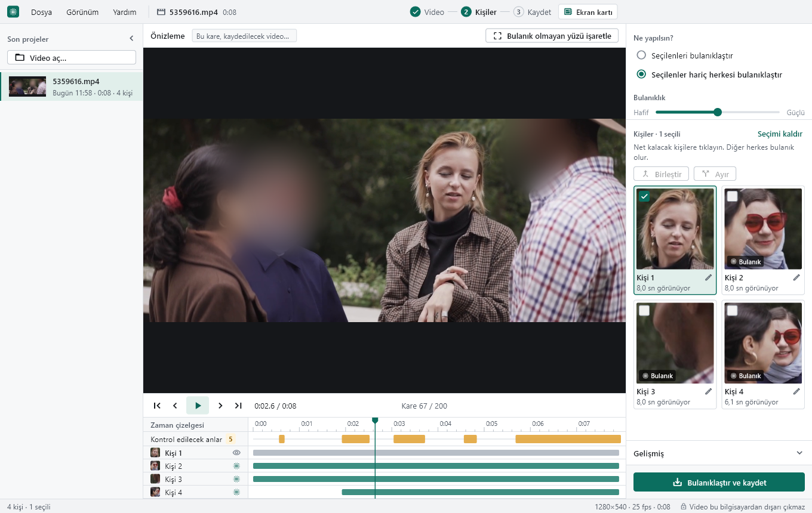

# Zoria Blur

**Offline face blurring for videos.** Zoria Blur finds every face in a video, groups the faces into
people, and lets you choose who gets blurred: one person, a few people, or everyone except the
people you keep. The video never leaves your computer.

It is built for real footage, not studio clips: people turn their heads, walk behind each other,
leave the frame and come back, or show up as tiny faces in a crowd. Every export is followed by an
automatic check that looks for any face that should have been blurred and is still sharp.

> **Türkçe dil desteği:** The Windows app's interface is fully in Turkish.
> The engine, its command line and this documentation are in English.

**Download:** the Windows installer is on the [Releases page](https://github.com/ZoriaSoft/zoria-blur/releases/latest) (Windows 10/11, 64-bit, works offline).

## Examples

All clips below are free stock footage from [Pexels](https://www.pexels.com) (credits at the
bottom). Left: the original. Right: Zoria Blur's output. Click a preview for the full MP4.

### Blur everyone except one person
Four friends talking in a park, seen from the front, from the side and from the back. Only the woman
with short blonde hair stays visible.

[](docs/demo/01-keep-one-person.mp4)

### Pixelate one chosen person
Three students walking towards the camera. One of them turns her head away and back; the engine
first saw her front and side views as two people, one `merge` joined them, and she stays pixelated
in every frame.

[](docs/demo/02-pixelate-one-person.mp4)

### Blur every face in a crowd
A busy pedestrian street with dozens of people, many of them small and far away. Analysed in
`thorough` mode, which scans the frame in tiles to catch small faces.

[](docs/demo/03-crowd-blur-all.mp4)

### Blur one person as he moves and turns
A group by a river. The man in the purple shirt turns from profile towards the camera while his
friends move around him; his face stays blurred in every frame.

[](docs/demo/04-blur-one-moving-person.mp4)

Automatic leak check on these exports (default settings, every 3rd frame checked):

| Example | Mode | People found | Faces left sharp |
|---|---|---|---|
| Keep one person | blur except | 4 | 0 |
| Pixelate one person | blur selected | 6 (5 after one merge) | 0 |
| Crowd | blur except, nobody kept | 91 | 0 |
| One moving person | blur selected | 15 | 0 |

In the crowd clip most far-away faces are too small for the check to judge, so the result there
also relies on body tracking (heads are blurred from the body box when no face is seen).


## What it does

- **Choose people, not boxes.** Faces are tracked and grouped into people with face recognition
  (ArcFace embeddings), so you pick "Person 2" once instead of fixing boxes frame by frame.
- **Two modes.** *Blur selected* (blur the people you pick) or *blur except* (blur everyone but the
  people you keep). Gaussian blur or pixelation, adjustable strength.
- **Body tracking keeps heads covered.** Each person is also tracked by their body (YOLOX), so their
  head stays blurred when the face is turned away, hidden behind someone or too small to detect.
- **Fail-safe by design.** When the engine is unsure whether a face belongs to a kept person, it
  blurs it.
- **Small faces.** `balanced` mode (default) switches to tiled detection by itself when it sees
  small people; `thorough` does it on every frame.
- **Automatic leak check.** After every export a QA pass re-detects faces in the result and reports
  any sharp face that should have been blurred, with the exact time ranges.
- **Fix mistakes.** Merge two people, split a wrongly grouped track, rename people, or draw one box
  where a face was missed (optical flow carries it forward).
- **Runs on what you have.** NVIDIA GPU (CUDA) first, then DirectML (AMD, Intel and other GPUs),
  then the CPU. The app checks your PC on first start and picks the fastest option.
- **Keeps the audio.** The original audio track is copied into the blurred video untouched.

## The Windows app (Turkish UI)

The desktop app (`ui/`, Flutter for Windows) is a one-window video tool in Turkish:



1. **Video aç** – open or drop a video (mp4, mov, mkv, avi, webm and more).
2. **Başlat** – the face search runs with progress, phase and remaining time.
3. **Kişiler** – pick people from their thumbnails, merge or split them, rename them.
4. **Bulanıklaştır ve kaydet** – export; the result panel shows the leak check in plain words.

It has a live blurred preview, a timeline with one row per person and markers for moments worth a
second look, light and dark themes, and a first-run system check (*Sistem kontrolü*) that tests CUDA,
DirectML and the CPU on your machine.

## Engine and command line

The engine is a Python package (`zoria_blur/`) that runs on Windows and Linux. The app calls it, but
you can use it directly.

### Install (Python 3.12)

```bash
python -m venv .venv
source .venv/bin/activate          # Windows: .venv\Scripts\activate
pip install -r requirements.txt
python scripts/download_models.py
```

ffmpeg 5.1 or newer is required. It is found via `--ffmpeg PATH`, the `ZORIA_FFMPEG` variable,
`bin/ffmpeg(.exe)` next to the app, the `imageio-ffmpeg` package, or your PATH.

### Use

```bash
# 1) analyze: detect, track and group faces -> myvideo_zoria/project.json + thumbnails per person
python -m zoria_blur analyze myvideo.mp4

# look at myvideo_zoria/thumbs/person_001 ... and pick ids
python -m zoria_blur persons myvideo_zoria

# 2) render
python -m zoria_blur render myvideo.mp4 --mode blur-except   --persons 1   -o out.mp4
python -m zoria_blur render myvideo.mp4 --mode blur-selected --persons 2,3 --style pixelate

# fix grouping mistakes
python -m zoria_blur merge  myvideo_zoria 5 7            # person 7 becomes part of person 5
python -m zoria_blur split  myvideo_zoria --tracks 12    # track 12 becomes a new person
python -m zoria_blur rename myvideo_zoria 3 "Ali"

# check a rendered file again (also runs automatically after render)
python -m zoria_blur qa out.mp4 -p myvideo_zoria
```

Useful options: `--det-mode fast|balanced|thorough` (small faces), `--backend cpu|dml|cuda|auto`,
`--style gaussian|pixelate`, `--strength 1.5`. Every command prints one JSON object, and
`--json-progress` adds progress events, which is how the app talks to the engine.

The full option list, the design of each stage, measurements and known limitations are in
[docs/ENGINEERING.md](docs/ENGINEERING.md).

### How it works

```
frame ─► SCRFD faces ─► ArcFace embeddings ─► face tracks ─┐
   └───► YOLOX bodies ─► body tracks ──────────────────────┤
                                                           ▼
            face <-> body association ─► people (clustering) ─► render ─► QA leak check
```

## Building the Windows app

Requirements: Windows, Flutter (Windows desktop), Python 3.12, Inno Setup 6.

```powershell
# optional NVIDIA engine first
powershell -ExecutionPolicy Bypass -File packaging\build_cuda_engine.ps1
# engine (PyInstaller, DirectML) + Flutter app -> dist\ZoriaBlur, then the installer
powershell -ExecutionPolicy Bypass -File packaging\build_windows.ps1
```

The script expects a `.venv-dml` environment (requirements with `onnxruntime-directml` and
`pyinstaller`), `bin\ffmpeg.exe` + `ffprobe.exe` and the models in `models\`; see the header of
`packaging\build_windows.ps1` for every switch.

Tests: `python tests/test_engine.py` (engine, no video needed) and `flutter test` in `ui/`.

## Licenses — please read

- **Code:** MIT, see [LICENSE](LICENSE).
- **Face models are not MIT.** The face detector (SCRFD) and face recognition (ArcFace) weights are
  InsightFace pretrained models, licensed for **non-commercial research use only**. They are not in
  this repository; `scripts/download_models.py` fetches them. For commercial use you need a licence
  from InsightFace or replacement models with permissive licences (the engine only depends on the
  ONNX input/output shapes, so swapping them is contained to `detector.py` and `embedder.py`).
- **Body detector:** YOLOX (Megvii), code and weights Apache-2.0.
- **Libraries:** NumPy (BSD), OpenCV (Apache-2.0), ONNX Runtime (MIT), ffmpeg (LGPL/GPL depending
  on the build). Details in `packaging/THIRD_PARTY.txt`.

## Example footage credits

All example clips are from Pexels and used under the [Pexels License](https://www.pexels.com/license/).
They were trimmed, scaled and blurred for these demos.

| Example | Clip on Pexels | Author |
|---|---|---|
| Keep one person | [Friends gathered at a park and talking](https://www.pexels.com/video/friends-gathered-at-a-park-and-talking-to-each-other-5359616/) | Pavel Danilyuk |
| Pixelate one person | [A group of friends talking while walking](https://www.pexels.com/video/a-group-of-friends-talking-while-walking-6145693/) | Keira Burton |
| Crowd | [Busy urban street scene with people walking](https://www.pexels.com/video/busy-urban-street-scene-with-people-walking-29152591/) | Sururi Ballıdağ |
| One moving person | [Group of friends having conversation while walking](https://www.pexels.com/video/group-of-friends-having-conversation-while-walking-8774981/) | Kampus Production |

---

Made by [ZoriaSoft](https://github.com/ZoriaSoft).
